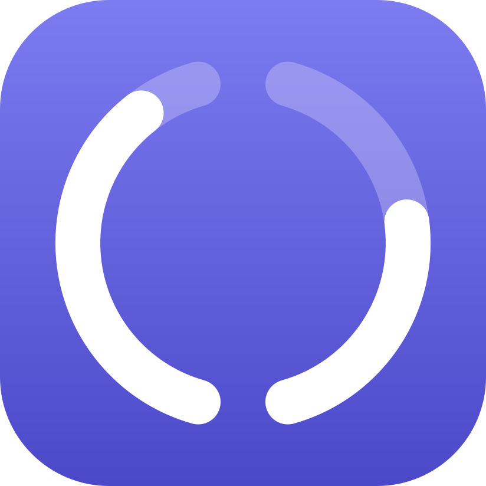

# Halfsies

Split keyboard in your Mac menu bar.

macOS shows only one battery level for a Bluetooth keyboard, which for a ZMK split is the half your Mac connects to.
Halfsies shows both halves, left then right, as a split ring followed by the percentages, for example `86% 39%`.
Each side of the ring fills from the bottom with that half's battery and turns red at 20% or less.
A half that is asleep or out of range shows `-` and a dotted side.
Turn on Compact menu bar in Settings to show only the ring; click it to see the percentages.
The menu bar item disappears while no keyboard is connected; open Halfsies again to reach its settings.

## Requirements

- macOS 26 or later.
- A ZMK split keyboard connected to the Mac over Bluetooth.
- Firmware that reports the other half's battery to the Mac (see below).

### Firmware setting

By default ZMK reports only the central half's battery to the host.
Add these lines to your keyboard's `.conf` file (for the central half, usually the left one), rebuild, and flash the central half:

```ini
CONFIG_ZMK_SPLIT_BLE_CENTRAL_BATTERY_LEVEL_FETCHING=y
CONFIG_ZMK_SPLIT_BLE_CENTRAL_BATTERY_LEVEL_PROXY=y
```

See the [ZMK battery configuration](https://zmk.dev/docs/config/battery) docs for details.
macOS caches the keyboard's Bluetooth services, so if the second half still does not show up after flashing, remove the keyboard in System Settings > Bluetooth and pair it again.

## Troubleshooting

If nothing shows in the menu bar, open Halfsies again from Finder or Spotlight.
The top of its Settings window says what is wrong:

- **Waiting for Bluetooth permission**: allow Halfsies when macOS asks.
- **Not allowed to use Bluetooth**: click Open Bluetooth Settings and turn on Halfsies in Privacy & Security > Bluetooth.
- **Bluetooth is off**: turn Bluetooth on.
- **No keyboard connected**: connect the keyboard in System Settings > Bluetooth.
- **Reports only one battery**: the firmware does not report the other half; see [Firmware setting](#firmware-setting), including the re-pair step.

Builds you make yourself are ad-hoc signed, so macOS may ask for Bluetooth permission again after each rebuild; see [Building](#building).

## Building

You need Xcode 27 and [XcodeGen](https://github.com/yonaskolb/XcodeGen) (`brew install xcodegen`).

```sh
xcodegen generate
open Halfsies.xcodeproj
```

Or from the command line:

```sh
xcodegen generate
xcodebuild -project Halfsies.xcodeproj -scheme Halfsies -derivedDataPath build/DerivedData build
open build/DerivedData/Build/Products/Debug/Halfsies.app
```

Builds are ad-hoc signed by default, so macOS asks for Bluetooth permission again after each rebuild.
To avoid that, see [Config/Signing.xcconfig](Config/Signing.xcconfig).

Run the logic tests without Xcode:

```sh
swift test --package-path HalfsiesKit
```

## Layout

- `App/` is the thin app target: app entry point, Settings window, launch at login.
- `HalfsiesKit/` is a Swift package with nearly all the code:
  - `HalfsiesCore`: the keyboard model and pure logic, such as identifying each half from its Bluetooth descriptors.
  - `HalfsiesBLE`: reads battery levels with CoreBluetooth; the only module that imports it.
  - `HalfsiesBattery`: observable battery state and settings.
  - `HalfsiesUI`: SwiftUI views.
- `docs/design.md` records the design decisions, and `docs/research/` the research behind them.

## License

[MIT](LICENSE)
